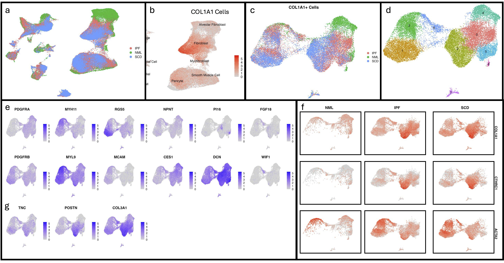
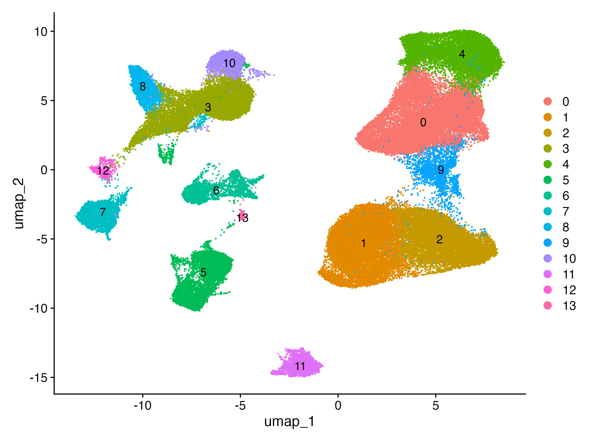
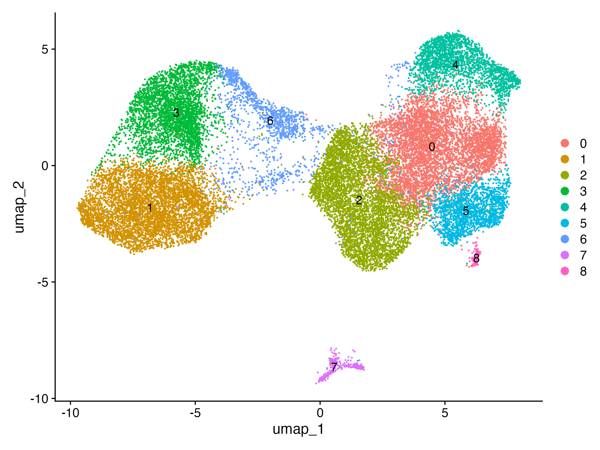
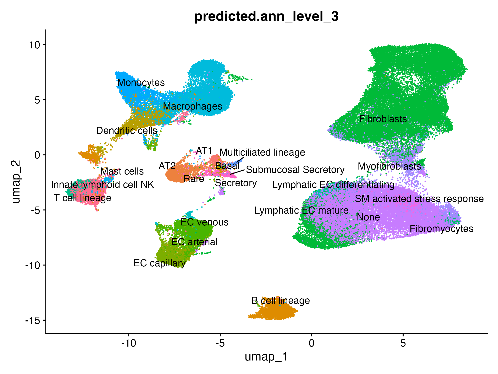
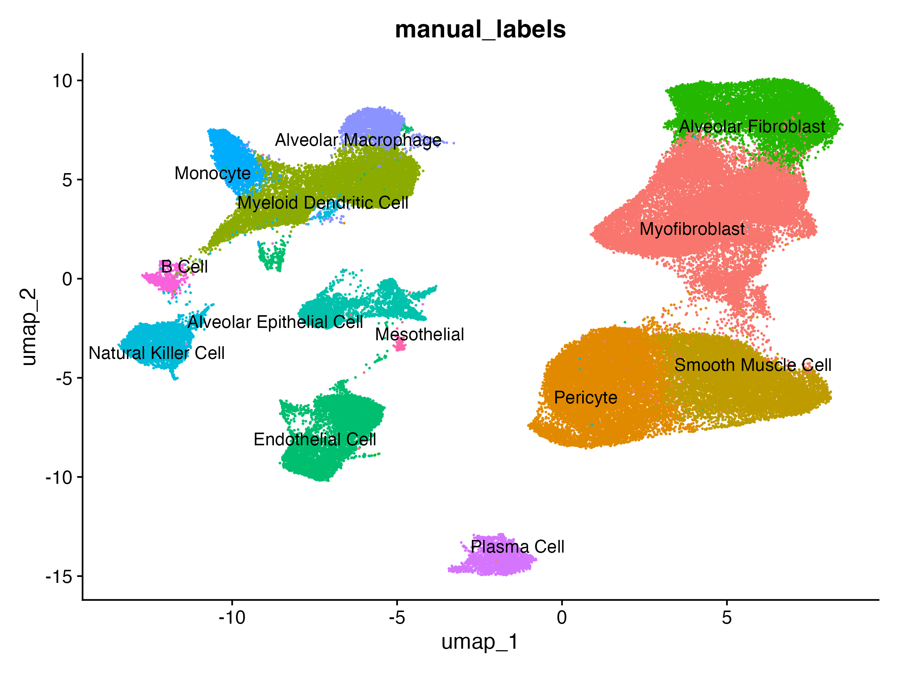

# Reproducing Figure 5: Identify Collagen-Producing Cells within Normal & Fibrotic Lungs

## Source Publication

**Citation:** Tsukui, T., Sun, K. H., Wetter, J. B., Wilson-Kanamori, J. R., Hazelwood, L. A., Henderson, N. C., Adams, T. S., Schupp, J. C., Poli, S. D., Rosas, I. O., Kaminski, N., Matthay, M. A., Wolters, P. J., & Sheppard, D. (2020). "Collagen-producing lung cell atlas identifies multiple subsets with distinct localization and relevance to fibrosis." *Nature communications*, 11(1), 1920. doi: [10.1038/s41467-020-15647-5](https://doi.org/10.1038/s41467-020-15647-5). <PMID:32317643>, PMCID:[PMC7174390](https://pmc.ncbi.nlm.nih.gov/articles/PMC7174390/)

**Abstract Summary:** The study performed scRNA-sequencing to identify collagen-producing cells within normal and fibrotic (Idiopathic pulmonary fibrosis & Scleroderma) lungs in humans and mouse. The study characterized the expression of Cthrc1 (collagen triple helix repeat containing 1), which was seen in fibrotic lungs and was found to produce high levels of collagen in mouse lungs. In humans, there was similar heterogeneity and CTHRC1-expressing fibroblasts present.

## Data Availability

Per the original paper's Data Availability Statement:

- **scRNA-seq data:** deposited in GEO, accession [**GSE132771**](https://www.ncbi.nlm.nih.gov/geo/query/acc.cgi?acc=GSE132771)
- **scRNA-seq data (mesenchymal subset):** deposited in GEO, accession [**GSE147066**](https://www.ncbi.nlm.nih.gov/geo/query/acc.cgi?acc=GSE147066)

## Results

### Figure 5

*Figure 1 (v1). Reproduction of Figure 5 from Tsukui et al. (Nature Communications, 2020) using GEO dataset GSE132771. Panels follow the layout of the published figure, showing [e.g., whole-lung cell populations (a–b) and COL1A1+ fibroblast clusters (c–g)].*

#### Batch Correction

**Status:** v1 shows batch-corrected results. A side-by-side comparison with uncorrected data is in progress to show the effect of batch correction.

#### Clustering

*Figure 2 (v1). Reproduction of Figure 5a from Tsukui et al. (Nature Communications, 2020) using the whole-lung (\_All) samples from GSE132771, showing 13 clusters.*

*Figure 3 (v1). Reproduction of Figure 5d from Tsukui et al. (Nature Communications, 2020) using the lineage-negative (\_Lin) samples from GSE132771, showing 9 clusters.*

#### Cell Type Annotation

Annotation was conducted using Azimuth (automatic) and Cell Marker 3.0 (manual) to compare the difference in annotation. The result of each type of annotation was compared side-by-side and disagreements were resolved by checking marker genes directly.

| Automatic (Azimuth) | Manual (Cell Marker 3.0) |
|:----------------------------------:|:----------------------------------:|
|  |  |

## Software

| Tool   | Version | Purpose              | Citation        |
|--------|---------|----------------------|-----------------|
| R      | 4.5.0   | Analysis environment | R Core Team     |
| Seurat | 5.5.1   | scRNA-seq framework  | Hao et al. 2024 |

## Contact

Project Lead \| **Vy T. Dang**\
[LinkedIn](https://www.linkedin.com/in/vy-dang-t/) \| [GitHub](https://github.com/veedeeve)\
Team Member \| **Chantera Lazard**\
[LinkedIn](https://www.linkedin.com/in/chantera-lazard/) \| [GitHub](https://github.com/tera90223)
